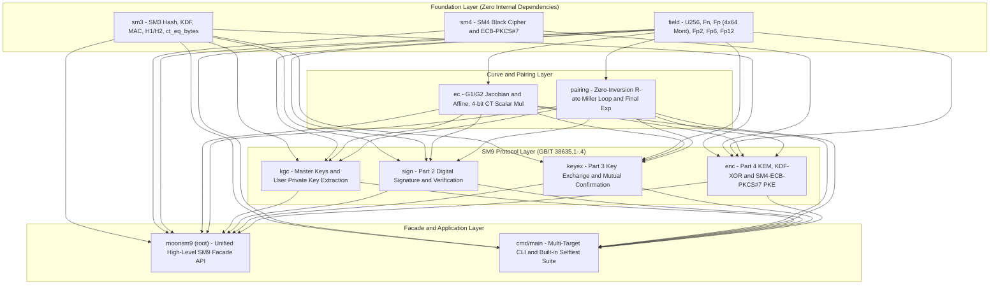

# moonsm9 Architecture & Mathematical Design

`CoolrfulDARkness/moonsm9` is a pure MoonBit, zero-FFI, zero-external-dependency implementation of the complete **SM9 Identity-Based Cryptographic Algorithms** suite (**GB/T 38635-2020** / **GM/T 0044-2016**), together with its required symmetric and hash primitives **SM3** (**GB/T 32905-2016**) and **SM4** (**GB/T 32907-2016**).

---

## 1. Design Philosophy: Pure MoonBit, Zero FFI, Bit-Identical Multi-Target

Cryptographic libraries built on foreign C bindings (`OpenSSL`, `GmSSL`, `libgmp`) forfeit portability across WebAssembly sandboxes, browser/Node.js JavaScript runtimes, and native binaries—and introduce ABI, memory-safety, and supply-chain boundaries. `moonsm9` takes a clean-room approach:

1. **Zero FFI & Zero Third-Party Dependencies**: Every layer—from 256-bit Montgomery multiplication and sextic twist arithmetic to R-ate bilinear pairings and all four SM9 protocols—is written exclusively in safe MoonBit (`moonbitlang/core` only).
2. **Bit-Identical Cross-Target Semantics**: All wide multiplications use explicit 32×32→64-bit limb splitting (`mul_u64_wide`) over standard `UInt64`, guaranteeing bit-for-bit identical outputs across `wasm`, `wasm-gc`, `js`, and `native`.
3. **Type-Enforced Cryptographic Invariants**: Curve points (`G1Affine`, `G2Affine`), KGC keys (`SignMasterPrivateKey`, `SignMasterPublicKey`, `SignUserPrivateKey`, `EncMasterPrivateKey`, `EncMasterPublicKey`, `EncUserPrivateKey`), and `Signature` keep their fields private (`priv`) so invalid, off-curve, or non-subgroup values cannot be constructed through public APIs.
4. **Zero-Warning Engineering Discipline**: Every package compiles and passes tests with `-d` (warnings treated strictly) and maintains locked `.mbti` package interfaces verified via `moon info` and `moon fmt --check`.

---

## 2. Layered 10-Package Architecture

`moonsm9` is structured as a strict directed acyclic graph (DAG) with 9 cohesive library sub-packages, a unified root facade package, and a multi-target executable CLI:

| Package | Responsibility | Internal Dependencies |
|---|---|---|
| `CoolrfulDARkness/moonsm9/sm3` | Streaming/one-shot SM3, `KDF`, `MAC`, `H1`/`H2` (320-bit reduction), `ct_eq_bytes`, hex codec | None |
| `CoolrfulDARkness/moonsm9/sm4` | 128-bit SM4 cipher (`Sm4Key`) & constant-time validated `SM4-ECB-PKCS#7` | None |
| `CoolrfulDARkness/moonsm9/field` | `U256`, scalar field `Fn`, 4×64-bit Montgomery `Fp`, tower `Fp2`/`Fp6`/`Fp12`, 13 Frobenius constants | None |
| `CoolrfulDARkness/moonsm9/ec` | `G1Affine`/`G1Jac`, `G2Affine`/`G2Jac`, constant-time 4-bit window scalar mul, `G2` subgroup check, strict codecs | `field` |
| `CoolrfulDARkness/moonsm9/pairing` | Optimal R-ate `miller_loop`, Fuentes-Castaneda `final_exponentiation`, `pair_coords`, joint `pair_product_coords` | `field` |
| `CoolrfulDARkness/moonsm9/kgc` | Master key generation (`from_seed`/`from_bytes_strict`), user private key extraction (`HID_SIGN`/`HID_KEYEX`/`HID_ENC`), `precompute_g` | `sm3`, `field`, `ec`, `pairing` |
| `CoolrfulDARkness/moonsm9/sign` | GB/T 38635.2 signature (`sign_with_r`, `sign_deterministic`, `verify`, precomputed variants, 96B/97B codecs) | `sm3`, `field`, `ec`, `pairing` |
| `CoolrfulDARkness/moonsm9/keyex` | GB/T 38635.3 key exchange (`generate_ephemeral`, `responder_exchange`, `initiator_exchange`, mutual confirmation) | `sm3`, `field`, `ec`, `pairing` |
| `CoolrfulDARkness/moonsm9/enc` | GB/T 38635.4 KEM & PKE (`EncMode::KdfXor`, `EncMode::Sm4EcbPkcs7`, MAC-then-decrypt) | `sm3`, `sm4`, `field`, `ec`, `pairing` |
| `CoolrfulDARkness/moonsm9` & `cmd/main` | Unified top-level facade + standalone CLI (`selftest`, `sm3`, `keygen`, `sign`, `keyex`, `encrypt`) | All sub-packages |

---

## 3. Mathematical & Algorithmic Deep Dive

### 3.1 BN256 Curve Parameters (GB/T 38635.5-2020)

SM9 operates over a 256-bit Barreto-Naehrig (BN) pairing-friendly curve with embedding degree $k = 12$ parameterized by:

$$t = \texttt{0x600000000058f98a}$$

| Parameter | Formula | Hexadecimal Value (Big-Endian) |
|---|---|---|
| Base prime $p$ | $36t^4 + 36t^3 + 24t^2 + 6t + 1$ | `0xb640000002a3a6f1d603ab4ff58ec74521f2934b1a7aeedbe56f9b27e351457d` |
| Group order $N$ | $36t^4 + 36t^3 + 18t^2 + 6t + 1$ | `0xb640000002a3a6f1d603ab4ff58ec74449f2934b18ea8beee56ee19cd69ecf25` |
| Frobenius trace $t_r$ | $p + 1 - N = 6t^2 + 1$ | `0x00000000000000000000000000000000d8000000019062ed0000b98b0cb27659` |
| $\mathbb{G}_1$ cofactor $h_1$ | $1$ ($\#E(\mathbb{F}_p) = N$ is prime) | `0x01` |
| $\mathbb{G}_2$ cofactor $h_2$ | $2p - N$ | `0xb640000002a3a6f1d603ab4ff58ec745f9f2934b1c0b51c8e57054b2f003bbd5` |

- **Base curve $E(\mathbb{F}_p)$**: $y^2 = x^3 + 5$ ($a = 0, b = 5$, $p \equiv 5 \pmod 8$, $p \equiv 1 \pmod{12}$).
- **Quadratic extension**: $\mathbb{F}_{p^2} = \mathbb{F}_p[u] / (u^2 + 2)$ ($\beta = -2$).
- **Sextic D-type twist $E'(\mathbb{F}_{p^2})$**:
  $$E'(\mathbb{F}_{p^2}): y^2 = x^3 + b', \quad b' = 5u$$
  Note that GB/T 38635.5 defines a **D-type twist** with $b' = 5u$ (represented as $(c_0=0, c_1=5)$ in $\mathbb{F}_{p^2}$), **not** an M-type twist $5/u$. The twisting isomorphism $\psi: E'(\mathbb{F}_{p^2}) \to E(\mathbb{F}_{p^{12}})$ is given by $\psi(x', y') = (x' w^{-2},\ y' w^{-3})$, satisfying $(y'w^{-3})^2 = {y'}^2 / u = ({x'}^3 + 5u)/u = (x'w^{-2})^3 + 5$.
- **Generators**:
  - $P_1 \in \mathbb{G}_1 \subset E(\mathbb{F}_p)$:
    - $x_{P_1} = \texttt{93de051d62bf718ff5ed0704487d01d6e1e4086909dc3280e8c4e4817c66dddd}$
    - $y_{P_1} = \texttt{21fe8dda4f21e607631065125c395bbc1c1c00cbfa6024350c464cd70a3ea616}$
  - $P_2 \in \mathbb{G}_2 \subset E'(\mathbb{F}_{p^2})$ ($x = x_1 u + x_0$, $y = y_1 u + y_0$):
    - $x_{P_2,1} = \texttt{85aef3d078640c98597b6027b441a01ff1dd2c190f5e93c454806c11d8806141}$
    - $x_{P_2,0} = \texttt{3722755292130b08d2aab97fd34ec120ee265948d19c17abf9b7213baf82d65b}$
    - $y_{P_2,1} = \texttt{17509b092e845c1266ba0d262cbee6ed0736a96fa347c8bd856dc76b84ebeb96}$
    - $y_{P_2,0} = \texttt{a7cf28d519be3da65f3170153d278ff247efba98a71a08116215bba5c999a7c7}$

### 3.2 4×64-bit Montgomery Prime Field Arithmetic (`field`)

Both the base prime field $\mathbb{F}_p$ (`Fp`) and scalar field $\mathbb{F}_N$ (`Fn`) store elements internally as 4 little-endian 64-bit Montgomery limbs $aR \bmod m$ with $R = 2^{256}$:

- **Overflow-Free Multi-Target `mac`**: MoonBit targets Wasm, JS, and Native uniformly over 64-bit unsigned integers (`UInt64`). In `field/u256.mbt`, `mul_u64_wide(a, b)` splits each 64-bit operand into 32-bit halves $(a_1 \cdot 2^{32} + a_0)(b_1 \cdot 2^{32} + b_0)$ and accumulates cross terms strictly within `UInt64` without overflow. Together with branchless bitwise `adc` and `sbb`, `mac(a, b, c, carry)` computes $a + b \cdot c + \text{carry} \to (\text{lo}, \text{hi})$ identically on every backend.
- **Unrolled 4-Limb CIOS Montgomery Multiplication**: `fp_mont_mul_raw` unrolls all 4 limbs of the Coarsely Integrated Operand Scanning (CIOS) algorithm with precomputed $-p^{-1} \bmod 2^{64} = \texttt{0x892bc42c2f2ee42b}$ (and $-N^{-1} \bmod 2^{64} = \texttt{0x1d02662351974b53}$ for `Fn`), finishing with a branchless conditional subtraction (`fp_sub_if_gte`) using `ct_select_u64`.
- **Constant-Time Inversion & Square Root**: `Fp::inv` and `Fn::inv` use Fermat's Little Theorem ($a^{p-2} \bmod p$ and $a^{N-2} \bmod N$) via fixed-sequence exponentiation, eliminating variable-time extended GCD branches. Because $p \equiv 5 \pmod 8$, `Fp::sqrt` implements Atkin's square-root algorithm using $(p - 5)/8$ to support strict compressed $\mathbb{G}_1$ point decoding.

### 3.3 Extension Field Tower & Zero-Cost Standard Basis Isomorphism

GB/T 38635.1 and GB/T 38635.5 define $\mathbb{F}_{p^{12}}$ using **Tower A** ($\mathbb{F}_p \to \mathbb{F}_{p^2} \to \mathbb{F}_{p^4} \to \mathbb{F}_{p^{12}}$):
- $\mathbb{F}_{p^2} = \mathbb{F}_p[u]/(u^2 + 2)$
- $\mathbb{F}_{p^4} = \mathbb{F}_{p^2}[v]/(v^2 - u)$
- $\mathbb{F}_{p^{12}} = \mathbb{F}_{p^4}[w]/(w^3 - v)$

For optimal R-ate Miller line multiplications (`mul_by_014`) and Granger-Scott cyclotomic squaring (`cyclotomic_sqr`), `moonsm9/field` implements the isomorphic **Tower B** ($\mathbb{F}_p \to \mathbb{F}_{p^2} \to \mathbb{F}_{p^6} \to \mathbb{F}_{p^{12}}$):
- $\mathbb{F}_{p^6} = \mathbb{F}_{p^2}[s]/(s^3 - u)$, where $s = w^2$ ($s^3 = w^6 = u$)
- $\mathbb{F}_{p^{12}} = \mathbb{F}_{p^6}[t]/(t^2 - s)$, where $t = w$ ($t^2 = w^2 = s$, $v = w^3 = st$)

Expanding an element $F = (b_2 s^2 + b_1 s + b_0) t + (a_2 s^2 + a_1 s + a_0)$ (`c0 = (a0, a1, a2)`, `c1 = (b0, b1, b2)`) in powers of $w = t$ yields:

$$F = b_2 w^5 + a_2 w^4 + b_1 w^3 + a_1 w^2 + b_0 w + a_0$$

Comparing directly against Tower A's $f = (f_{2,1} v + f_{2,0}) w^2 + (f_{1,1} v + f_{1,0}) w + (f_{0,1} v + f_{0,0})$ yields a **zero-multiplication, pure coefficient permutation** for the 384-byte GB/T 38635 `FE2OS` wire format:

| Byte Offset (384 B) | Power of $w$ | Standard Tower A (`Fp4[w]`) | Internal Tower B (`Fp6[t]`) | 64 B `Fp2` Layout |
|---|---|---|---|---|
| `0..63` | $w^5 = vw^2 = s^2 t$ | $f_{2,1}$ | `c1.c2` ($b_2$) | `c1 (32B) \|\| c0 (32B)` |
| `64..127` | $w^2 = s$ | $f_{2,0}$ | `c0.c1` ($a_1$) | `c1 (32B) \|\| c0 (32B)` |
| `128..191` | $w^4 = vw = s^2$ | $f_{1,1}$ | `c0.c2` ($a_2$) | `c1 (32B) \|\| c0 (32B)` |
| `192..255` | $w^1 = t$ | $f_{1,0}$ | `c1.c0` ($b_0$) | `c1 (32B) \|\| c0 (32B)` |
| `256..319` | $w^3 = v = st$ | $f_{0,1}$ | `c1.c1` ($b_1$) | `c1 (32B) \|\| c0 (32B)` |
| `320..383` | $w^0 = 1$ | $f_{0,0}$ | `c0.c0` ($a_0$) | `c1 (32B) \|\| c0 (32B)` |

Thus `Fp12::to_bytes` simply serializes `[c1.c2, c0.c1, c0.c2, c1.c0, c1.c1, c0.c0]` with zero field operations, while `Fp12::from_bytes_strict` inverts the permutation and rejects any of the 12 `Fp` coordinates $\ge p$.

Arithmetic accelerations inside the tower include:
- **Karatsuba multiplication** in `Fp2`, `Fp6`, and `Fp12` (exploiting $u^2 = -2$, $s^3 = u$, $t^2 = s$).
- **2-mul `Fp2::sqr`** and **Chung-Hasan `Fp6::sqr`**.
- **Complex `Fp12::sqr`** (2 `Fp6` multiplications) and **Granger-Scott `Fp12::cyclotomic_sqr`** (3 `Fp4` squarings in the cyclotomic subgroup $G_{\Phi_6}(\mathbb{F}_{p^2})$).
- **Sparse `Fp12::mul_by_014(a, b, c)`** multiplying by Miller line functions $(a + bs) + (cs)t$ via `Fp6::mul_by_01` and `Fp6::mul_by_1`.
- **Frobenius endomorphisms** (`frobenius_p`, `frobenius_p2`, `frobenius_p3`) using 13 precomputed $\mathbb{F}_p$ Montgomery constants (`gamma_11..15`, `gamma_21..24`, `twist_frob_x1/y1/x2/y2`).

### 3.4 Constant-Time Elliptic Curve Groups & $\mathbb{G}_2$ Subgroup Defense (`ec`)

Both `G1Jac` (on $E(\mathbb{F}_p)$) and `G2Jac` (on $E'(\mathbb{F}_{p^2})$) use Jacobian coordinates $(X, Y, Z)$ representing $(X/Z^2, Y/Z^3)$ with infinity encoded by $Z = 0$:

- **Doubling (`dbl-2009-l`)**: Specialized for $a = 0$; naturally maps $Z = 0 \mapsto Z_3 = 2Y_1 Z_1 = 0$.
- **Complete Branchless Addition (`add-2007-bl` & `madd-2007-bl`)**: Evaluates the general addition formula alongside `self.double()` and selects among `add_res`, `identity()` ($P + (-P)$), `dbl` ($P + P$), `self` ($Q = \mathcal{O}$), and `other` ($P = \mathcal{O}$) exclusively via constant-time bitmasks (`ct_mask` + `ct_select`). No secret-dependent branches occur even on exceptional inputs.
- **Constant-Time 4-Bit Fixed-Window Scalar Multiplication**:
  1. Precomputes the 16-entry table $[0P, 1P, \dots, 15P]$ in Jacobian coordinates.
  2. Iterates MSB-to-LSB across all 64 4-bit nibbles of the 256-bit scalar: performs 4 doublings, linearly scans **all 16 table entries** using `ct_eq_u64_mask(nib, j)` and `ct_select` (zero secret-indexed memory access), and performs a complete constant-time addition into the accumulator.
- **$\mathbb{G}_2$ Prime-Order Subgroup Check (Anti-Cofactor / Small-Subgroup Defense)**:
  Because $h_1 = 1$, every point on $E(\mathbb{F}_p)$ lies in $\mathbb{G}_1$. By contrast, $E'(\mathbb{F}_{p^2})$ has large cofactor $h_2 = 2p - N \neq 1$. Accepting an on-curve twist point outside $\mathbb{G}_2$ enables small-subgroup / invalid-order pairing attacks. Therefore, `G2Affine::from_coords_checked`, `from_bytes_raw_strict`, and `from_bytes_uncompressed_strict` enforce **both** $y^2 = x^3 + 5u$ (`is_on_curve`) **and** $[N]Q = \mathcal{O}$ (`is_in_subgroup`) before returning `Some(G2Affine)`.

### 3.5 Zero-Inversion Optimal R-ate Pairing (`pairing`)

`moonsm9/pairing` computes the BN256 optimal R-ate pairing $e: \mathbb{G}_2 \times \mathbb{G}_1 \to \mathbb{G}_T \subset \mathbb{F}_{p^{12}}^*$ via:

1. **Zero-Inversion Jacobian Miller Loop (`miller_loop`)**:
   - Uses the 66-digit Non-Adjacent Form (NAF) of $6t + 2 = \texttt{0x02400000000215d93e}$, which has **only 11 non-zero digits**.
   - At each step, `line_double` and `line_add` update the twist point $T = (X_1, Y_1, Z_1) \in E'(\mathbb{F}_{p^2})$ in Jacobian coordinates and evaluate the scaled tangent/chord line directly at $P = (x_P, y_P) \in \mathbb{G}_1$:
     - Tangent scaling factor $\kappa = 2 Y_1 Z_1^3 \in \mathbb{F}_{p^2}^*$: $a = 3X_1^3 - 2Y_1^2$, $b = -(3X_1^2 Z_1^2) x_P$, $c = (2 Y_1 Z_1^3) y_P$.
     - Chord scaling factor $\kappa = H Z_1 \in \mathbb{F}_{p^2}^*$: $a = r x_R - y_R Z_3$, $b = -r x_P$, $c = Z_3 y_P$.
   - The resulting sparse line element $(a + b s) + (c s) t$ is absorbed via `Fp12::mul_by_014`. Because every projective scale factor lies in $\mathbb{F}_{p^2}^*$, it is completely annihilated by the easy part $p^6 - 1$ of the final exponentiation. **The entire Miller loop executes zero `Fp2::inv` inversions.**
   - Concludes with two twist Frobenius chord steps adding $Q_1 = \pi_p(Q)$ and $-Q_2 = -\pi_{p^2}(Q)$ (the last step uses `line_add_eval_only`, omitting unneeded $X_3, Y_3$).
2. **Fuentes-Castaneda Optimal Cyclotomic Final Exponentiation (`final_exponentiation`)**:
   - **Easy part**: $f_1 = f^{(p^6 - 1)(p^2 + 1)} = (\bar{f} \cdot f^{-1})^{p^2 + 1}$ places $f_1$ into the cyclotomic subgroup $G_{\Phi_6}(\mathbb{F}_{p^2})$ (where inversion is a free conjugation `conjugate()`). Only **one `Fp12::inv`** occurs across the entire pairing!
   - **Hard part**: Computes $f_1^{(p^4 - p^2 + 1)/N}$ via the Fuentes-Castaneda / Scott-Devegili cyclotomic addition chain requiring **only 3 `cyclotomic_pow_t`** (using the 64-digit NAF of $t$) and **4 `cyclotomic_sqr`**.
3. **Joint Multi-Pairing (`pair_product_coords`)**:
   - Computes $e(Q_1, P_1) \cdot e(Q_2, P_2)$ in a single interleaved `miller_loop_2` that shares all 65 `Fp12::sqr` squarings and a single `final_exponentiation`, nearly halving verification/multi-pairing cost.

### 3.6 SM9 Protocol Suite & Standard Interoperability Pitfalls

All four protocol packages (`kgc`, `sign`, `keyex`, `enc`) strictly enforce the subtle byte-level rules of GB/T 38635-2020 that frequently cause incompatibility across implementations:

| Interoperability Pitfall | GB/T 38635-2020 Standard Rule | `moonsm9` Enforcement |
|---|---|---|
| **$\mathbb{F}_{p^2}$ serialization (`FE2OS`)** | $c_0 + c_1 u$ is encoded as **`c1 \|\| c0`** ($u$-coefficient first, constant term second). | `Fp2::to_bytes` / `from_bytes_strict` and `G2Affine` 128B/129B codecs strictly follow `x1 \|\| x0 \|\| y1 \|\| y0`. |
| **`0x04` uncompressed prefix boundary** | External key/ASN.1 encodings carry `0x04` (65B $\mathbb{G}_1$, 129B $\mathbb{G}_2$). **Inside Part 3 `KDF`/$S_B$/$S_A$ ($R_A, R_B$) and Part 4 `KDF` ($C_1$), `0x04` is strictly forbidden** (raw 64B `x \|\| y` only). | `to_bytes_raw` (64B) is used inside all protocol hash/KDF inputs; `to_bytes_uncompressed` (65B/129B) is exposed separately for external transport/DER interop. |
| **Part 4 ciphertext layout** | Raw ciphertext order is **`C1 (64B) \|\| C3 (32B) \|\| C2`** (NOT `C1 \|\| C2 \|\| C3`). | `enc::encrypt_*` emits `C1 \|\| C3 \|\| C2`; `enc::decrypt` parses `[0:64]`, `[64:96]`, `[96:]`. |
| **Part 4 MAC formula (`C3`)** | GB/T 38635.1 §5.4.5 & Appendix A.2/A.3 define `MAC(K2, C2) = SM3(C2 \|\| K2)` (**direct SM3 concatenation**, `C2` before `K2`). | `@sm3.mac(k2, c2)` computes `SM3(c2 \|\| k2)`, matching GB/T 38635.4 Appendix A.2 & A.3 byte-for-byte. *(Note: historical GmSSL `sm9_do_encrypt` used `HMAC-SM3(K2, C2)`, which disagrees with GB/T 38635.4 Appendix A.)* |
| **`H1`/`H2` 40-byte scalar derivation** | 320-bit SM3 counter expansion (`tag = 0x01`/`0x02`) reduced via $(H_a \bmod (N - 1)) + 1 \in [1, N - 1]$. | `@sm3.h1` / `@sm3.h2` perform exact constant-time 320-bit modulo 256-bit reduction with no precision loss. |
| **`hid` domain separation** | `0x01` Signature, `0x02` Key Exchange, `0x03` Encryption/KEM. | Exposed as `kgc::HID_SIGN`, `kgc::HID_KEYEX`, `kgc::HID_ENC` and defaulted appropriately per protocol. |

---

## 4. Side-Channel & Security Engineering Boundaries

### Implemented Defenses
- **Constant-time field & group primitives**: Branchless `adc`/`sbb`, constant-time conditional reduction (`fp_sub_if_gte`), constant-time Fermat inversions, complete branchless Jacobian point addition, and 4-bit fixed-window scalar multiplication with full 16-entry linear table scans.
- **Constant-time verification**: MAC tags (`C3`), key-exchange confirmation hashes (`S_B`, `S_1`, `S_A`, `S_2`), signature scalar checks (`h2.ct_eq(sig.h)`), key equality (`ct_eq`), and SM4 PKCS#7 padding validation all avoid short-circuiting secret byte comparisons.
- **MAC-then-decrypt & strict parsing**: `enc::decrypt` verifies `C3` in constant time *before* decrypting `C2` or unpadding PKCS#7, preventing padding-oracle leakage. All point/scalar decoders reject wrong lengths, non-canonical coordinates ($\ge p$ or $\ge N$), infinity/all-zero encodings, off-curve points, wrong-twist points, and $\mathbb{G}_2$ cofactor points.
- **All-zero key rejection**: Part 3 `SK` and Part 4 `K`/`K1` are explicitly checked for all-zero outputs (returning `Err` in `_with_r` APIs and automatically retrying with incremented counter in deterministic APIs).
- **Domain-separated deterministic nonces**: `sign_deterministic`, `kem_encapsulate_deterministic`, and `encrypt_deterministic` derive ephemeral scalars via length-prefixed, domain-separated SM3 hashing over public parameters, private keys/recipient IDs, messages, caller-supplied entropy, and retry counters—eliminating weak-RNG nonce reuse while remaining pure MoonBit with zero OS RNG FFI.

### Explicit Scope & Known Boundaries
1. **Managed runtime & compiler backend limits**: While `moonsm9` eliminates secret-dependent branches and secret-indexed lookups in elliptic-curve and finite-field source code, higher-level execution environments (WebAssembly engines, V8/Node.js JITs, and C/LLVM optimizing backends) do not provide formal hardware-level constant-time guarantees against microarchitectural side channels without target-specific assembly inspection.
2. **SM4 S-box table lookups**: `sm4` uses standard 256-byte lookup S-box tables (`sbox`) rather than bitsliced AES/SM4 instructions; deployments requiring cache-timing immunity for standalone high-frequency SM4 on shared multi-tenant hosts should account for this boundary.
3. **Caller-supplied entropy**: Because `moonsm9` has zero OS FFI, callers invoking `*_from_seed` or `*_deterministic` APIs in production are responsible for supplying high-entropy seeds / fresh per-operation CSPRNG bytes from their host runtime.
4. **Audit status**: This library has been rigorously cross-verified against GB/T 38635-2020 official test vectors and adversarial tests (see [`VERIFICATION.md`](VERIFICATION.md)), but has not yet undergone a formal third-party cryptographic security audit for regulated HSM / commercial GM compliance certification.
